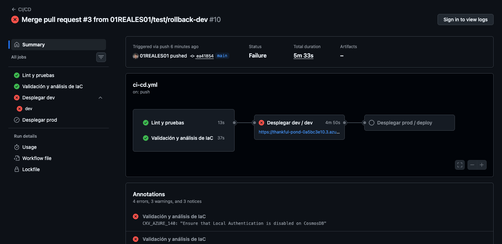
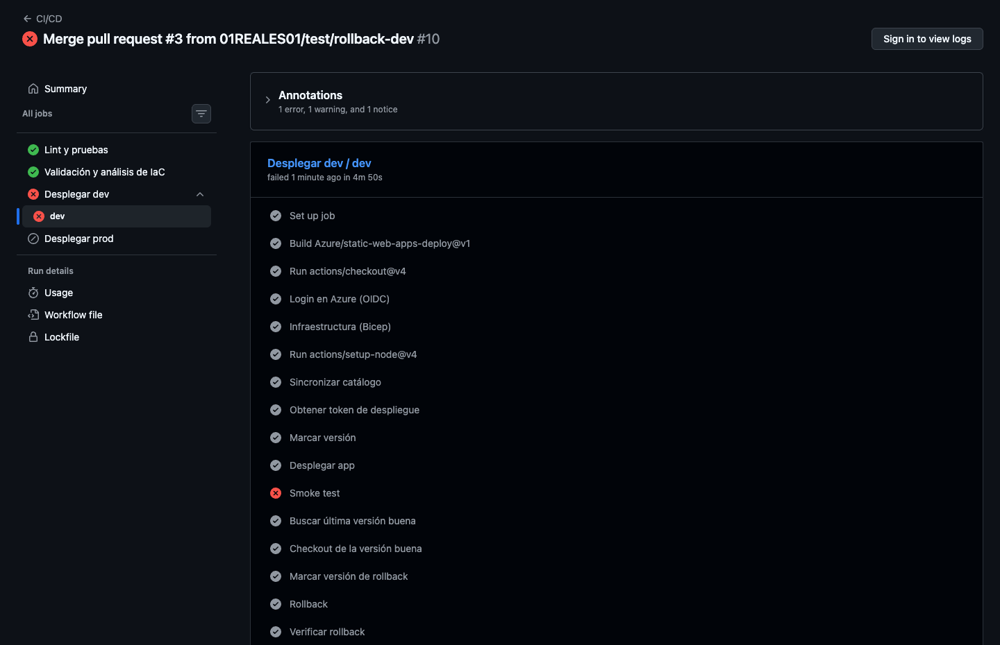

# Diseño del despliegue

> Borrador; se completa con tiempos medidos y capturas del pipeline.

## Etapas

| Etapa | Cuándo corre | Qué hace | Si falla |
|---|---|---|---|
| Lint y pruebas | PR y push a `main` | ESLint + pruebas unitarias (`node:test`) | Bloquea el merge y el despliegue |
| Validación de IaC | PR y push a `main` | Compila Bicep + Checkov (informativo) | Bloquea si Bicep no compila |
| CodeQL | PR, push y semanal | Análisis de seguridad del código | Reporta en Security |
| Desplegar dev | Push a `main` | Bicep (dev) → catálogo → app → smoke test | Rollback de dev; prod no se despliega |
| Desplegar prod | Tras dev, con aprobación | Bicep (prod) → catálogo → app → smoke test | Rollback de prod |

## Ambientes

Dos recursos de Static Web Apps separados (`swa-pandelacasa-dev` y `swa-pandelacasa-prod`), cada uno con su
base de datos en la misma cuenta de Cosmos DB (`panaderia-dev` y `panaderia-prod`, 400 RU/s cada una, dentro de
los 1000 RU/s gratuitos). Un cambio se promueve haciendo merge a `main`: llega primero a dev y, si el smoke test pasa
y se aprueba, a prod. El mismo commit se despliega en ambos.

No usamos los entornos de preview de Static Web Apps: con recursos separados, dev tiene su propia configuración y su
propia base de datos sin depender de cómo el servicio maneje la configuración de los previews, y ningún cambio en
prueba puede escribir en los datos de producción.

## Secretos e identidad

- GitHub Actions entra a Azure con **OIDC**: una identidad administrada con credenciales federadas, una por
  environment (`repo:<owner>/<repo>:environment:dev` y `...:prod`). No hay contraseñas guardadas.
- La identidad tiene rol **Contributor solo sobre `rg-pandelacasa`**, no sobre la suscripción.
- El token de despliegue de Static Web Apps se pide en cada ejecución con esa identidad y se enmascara en los logs.
- La clave de Cosmos DB la inyecta Bicep en la configuración de Static Web Apps; nunca está en el repositorio.
  (Las managed functions no soportan identidad administrada; en producción se usaría una Function App propia
  con identidad administrada y Key Vault. Ver ADR-003.)

## Catálogo

Los productos viven en `data/catalog.json`. En cada despliegue, `scripts/seed-catalog.js` valida ese archivo y lo
sincroniza con el contenedor `products` del ambiente: crea o actualiza cada producto y borra los que ya no están.
Así un cambio de precio o de producto entra por pull request, pasa por las pruebas y llega a dev y a prod sin pasos a
mano (es el cambio de la demo). La clave de Cosmos DB se pide en ese momento con la identidad OIDC y se enmascara.

El rollback vuelve a desplegar el código anterior pero no el catálogo anterior: los datos quedan en la última versión
sincronizada. Para el MVP es aceptable (el formato de los productos no cambia); si cambiara, el rollback también
tendría que volver a sincronizar el catálogo del commit bueno.

## Rollback

> Estado: **probado el 17 de noviembre de 2026** en dev (ejecución
> [44172753038](https://github.com/01REALES01/pan-de-la-casa/actions/runs/44172753038)).

**Prueba.** El PR #3 cambió a propósito la ruta de `/api/health` (las pruebas unitarias pasan, así que el pipeline
desplegó). Resultado, con la hora de los logs (UTC):

| Hora | Qué pasó |
|---|---|
| 20:48:47 | Empieza el smoke test: la versión nueva (`ea41854`) ya se sirve y la página responde |
| 20:48:47–20:50:47 | `/api/health` no responde `ok` en 20 intentos (6 s entre cada uno); el smoke test falla |
| — | El pipeline busca la última ejecución exitosa en `main`: `83a2102` |
| — | Vuelve a desplegar `83a2102` con `"rollback": true` en `version.json` |
| 20:51:33 | El smoke test de la versión buena pasa: health, catálogo (9 productos) y validación de pedidos |

Dev quedó sano en **menos de 3 minutos** desde que empezó el smoke test, sin intervención manual, y **prod no se
desplegó** (el job quedó en "skipped"). La ejecución queda en rojo para que se vea. El cambio se revirtió en el PR
siguiente.

**Cómo funciona:**

1. **Automático:** si el smoke test falla, el pipeline busca el commit de la última ejecución exitosa de `ci-cd.yml`
   en `main`, lo vuelve a desplegar y verifica con otro smoke test. La ejecución queda en rojo para que se vea.
2. **Manual:** en GitHub Actions, abrir una ejecución anterior exitosa y usar "Re-run all jobs", o hacer
   `git revert` del commit problemático y hacer merge.

## Smoke test

`scripts/smoke.sh` comprueba que el sitio sirve exactamente el commit desplegado (`/version.json`), que la página
principal responde, que `/api/health` devuelve `ok`, que `/api/products` devuelve productos (lee de Cosmos DB) y
que `POST /api/orders` rechaza un pedido inválido con 400. Se usa un pedido inválido a propósito para no crear
pedidos reales en producción en cada despliegue.

## Pendiente

- [ ] Medir la duración total del pipeline (la demo dura 5 minutos). Primera medición: CI + dev ≈ 3 min.
- [x] Probar el rollback automático en dev y guardar la captura (17 nov, ver arriba).
- [ ] Justificar los hallazgos de Checkov aceptados.
- [ ] Captura de una ejecución bloqueada por pruebas (la del rollback ya está).
