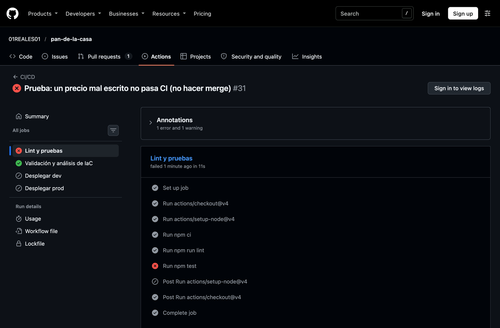

# Diseño del despliegue

## Etapas

| Etapa | Cuándo corre | Qué hace | Si falla |
|---|---|---|---|
| Lint y pruebas | PR y push a `main` | ESLint + pruebas unitarias (`node:test`) | Bloquea el merge y el despliegue |
| Validación de IaC | PR y push a `main` | Compila Bicep + Checkov (informativo) | Bloquea si Bicep no compila |
| CodeQL | PR, push y semanal | Análisis de seguridad del código | Reporta en Security |
| Desplegar dev | Push a `main` | Bicep (dev) → catálogo → app → smoke test | Rollback de dev; prod no se despliega |
| Desplegar prod | Tras dev, con aprobación | Bicep (prod) → catálogo → app → smoke test | Rollback de prod |

**Tiempos medidos** (ejecución [44764431992](https://github.com/01REALES01/pan-de-la-casa/actions/runs/44764431992),
merge del PR #9):

| Tramo | Duración |
|---|---|
| Lint y pruebas | 12 s |
| Validación de IaC | 35 s (en paralelo con las pruebas) |
| Desplegar dev, con su smoke test | 2 min 43 s |
| **Del merge a dev verificado** | **3 min 24 s** |
| Desplegar prod después de aprobar, con su smoke test | **2 min 15 s** |

Sin contar la espera de la aprobación, un cambio llega a producción en unos 6 minutos: cabe en los 5 minutos de la
demo si el merge se hace al empezar la presentación.

## Ambientes

Dos recursos de Static Web Apps separados (`swa-pandelacasa-dev` y `swa-pandelacasa-prod`), cada uno con su
base de datos en la misma cuenta de Cosmos DB (`panaderia-dev` y `panaderia-prod`, 400 RU/s cada una, dentro de
los 1000 RU/s gratuitos). Un cambio se promueve haciendo merge a `main`: llega primero a dev y, si el smoke test pasa
y se aprueba, a prod. El mismo commit se despliega en ambos.

No usamos los entornos de preview de Static Web Apps: con recursos separados, dev tiene su propia configuración y su
propia base de datos sin depender de cómo el servicio maneje la configuración de los previews, y ningún cambio en
prueba puede escribir en los datos de producción.

## Secretos e identidad

- GitHub Actions entra a Azure con **OIDC**: una identidad administrada con credenciales federadas, una por
  environment (`repo:<owner>/<repo>:environment:dev` y `...:prod`). No hay contraseñas guardadas.
- La identidad tiene rol **Contributor solo sobre `rg-pandelacasa`**, no sobre la suscripción.
- El token de despliegue de Static Web Apps se pide en cada ejecución con esa identidad y se enmascara en los logs.
- La clave de Cosmos DB la inyecta Bicep en la configuración de Static Web Apps; nunca está en el repositorio.
  (Las managed functions no soportan identidad administrada; en producción se usaría una Function App propia
  con identidad administrada y Key Vault. Ver ADR-003.)

## Catálogo

Los productos viven en `data/catalog.json`. En cada despliegue, `scripts/seed-catalog.js` valida ese archivo y lo
sincroniza con el contenedor `products` del ambiente: crea o actualiza cada producto y borra los que ya no están.
Así un cambio de precio o de producto entra por pull request, pasa por las pruebas y llega a dev y a prod sin pasos a
mano (es el cambio de la demo). La clave de Cosmos DB se pide en ese momento con la identidad OIDC y se enmascara.

El rollback vuelve a desplegar el código anterior pero no el catálogo anterior: los datos quedan en la última versión
sincronizada. Para el MVP es aceptable (el formato de los productos no cambia); si cambiara, el rollback también
tendría que volver a sincronizar el catálogo del commit bueno.

## Pruebas que bloquean el merge y el despliegue

> Estado: **probado el 22 de noviembre de 2026** (PR [#13](https://github.com/01REALES01/pan-de-la-casa/pull/13),
> ejecución [45108745569](https://github.com/01REALES01/pan-de-la-casa/actions/runs/45108745569)).

**Prueba.** El PR #13 escribió el precio del pandebono como `2.700`, con punto de miles, un error fácil al editar
`data/catalog.json`. En JSON eso es 2,7 pesos. Resultado:

- La prueba "el catálogo semilla es válido" falló con `Producto 1 (pandebono): el precio debe ser un entero
  positivo.` También falló la del pedido, que calcula el total con ese precio: 21 de 23 pruebas pasaron.
- El job "Lint y pruebas" quedó en rojo y GitHub marcó el PR como bloqueado (`mergeStateStatus: BLOCKED`): `main`
  exige que "Lint y pruebas" y "Validación y análisis de IaC" pasen antes del merge.
- "Desplegar dev" y "Desplegar prod" no corrieron: los despliegues dependen de las pruebas, también en un push a
  `main`.

El PR se cerró sin merge.



## Rollback

> Estado: **probado el 17 de noviembre de 2026** en dev (ejecución
> [44172753038](https://github.com/01REALES01/pan-de-la-casa/actions/runs/44172753038)).

**Prueba.** El PR #3 cambió a propósito la ruta de `/api/health` (las pruebas unitarias pasan, así que el pipeline
desplegó). Resultado, con la hora de los logs (UTC):

| Hora | Qué pasó |
|---|---|
| 20:48:47 | Empieza el smoke test: la versión nueva (`ea41854`) ya se sirve y la página responde |
| 20:48:47–20:50:47 | `/api/health` no responde `ok` en 20 intentos (6 s entre cada uno); el smoke test falla |
| — | El pipeline busca la última ejecución exitosa en `main`: `83a2102` |
| — | Vuelve a desplegar `83a2102` con `"rollback": true` en `version.json` |
| 20:51:33 | El smoke test de la versión buena pasa: health, catálogo (9 productos) y validación de pedidos |

Dev quedó sano en **menos de 3 minutos** desde que empezó el smoke test, sin intervención manual, y **prod no se
desplegó** (el job quedó en "skipped"). La ejecución queda en rojo para que se vea. El cambio se revirtió en el PR
siguiente.


**Cómo funciona:**


1. **Automático:** si el smoke test falla, el pipeline busca el commit de la última ejecución exitosa de `ci-cd.yml`
   por push a `main` (no cuenta la CI de un pull request), lo vuelve a desplegar y verifica con otro smoke test. La ejecución queda en rojo para que se vea.
2. **Manual:** en GitHub Actions, abrir una ejecución anterior exitosa y usar "Re-run all jobs", o hacer
   `git revert` del commit problemático y hacer merge.

## Restauración de datos (simulacro)

> Estado: **probado el 19 de noviembre de 2026** (noche, hora de Bogotá) con el procedimiento de ADR-004.

**Prueba.** Se restauró la cuenta completa de Cosmos DB (dev y prod) a una cuenta temporal, se borró a propósito el
pedido de prueba de dev (`AXZQ7`) en la cuenta original y se recuperó desde la temporal con `scripts/restore-orders.js`.
Horas en UTC (20 nov):

| Hora | Qué pasó |
|---|---|
| 03:14:32 | Conteo de la cuenta original: 9 productos por ambiente y 1 pedido en dev |
| 03:14:40 | `az cosmosdb restore` a la cuenta temporal, al instante 03:13:00 |
| 03:25:13 | La cuenta temporal queda lista: **10 min 33 s** |
| 03:25:26 | La cuenta temporal tiene exactamente los mismos documentos que la original |
| ≈ 03:26 | Se borra el pedido de dev en la cuenta original (quedan 0) y `restore-orders.js` lo recrea en segundos; el documento es idéntico al del respaldo |
| — | `/api/health` de dev responde `ok`; se borra la cuenta temporal |

**Resultado:** los datos volvieron en **unos 12 minutos** desde que se lanzó la restauración. El RTO exigido es 4 h:
aun sumando la detección (la alerta llega en unos 5 minutos) y la decisión del equipo, queda muy por debajo. Con más
datos la restauración tarda más, pero hoy la base pesa menos de 1 MB y el margen frente a 4 h es amplio.

**No probado:** la restauración de una base o un contenedor borrado dentro de la misma cuenta (ADR-004, paso 2),
porque exige borrar un contenedor real.

```bash
# 1. Restaurar a una cuenta temporal, al instante anterior al error (UTC)
az cosmosdb restore -g rg-pandelacasa -a <cuenta-original> -n <cuenta-temporal> -l centralus -t <AAAA-MM-DDTHH:MM:SSZ>
# 2. Copiar los pedidos de vuelta (primero con --dry-run para ver cuántos se recrean o reemplazan)
SOURCE_ENDPOINT=... SOURCE_KEY=... TARGET_ENDPOINT=... TARGET_KEY=... \
  COSMOS_DATABASE=panaderia-prod node scripts/restore-orders.js --dry-run
# 3. Borrar la cuenta temporal (cobra throughput mientras exista: no tiene free tier)
az cosmosdb delete -g rg-pandelacasa -n <cuenta-temporal> --yes
```

## Smoke test

`scripts/smoke.sh` comprueba que el sitio sirve exactamente el commit desplegado (`/version.json`), que la página
principal responde, que `/api/health` devuelve `ok`, que `/api/products` devuelve productos (lee de Cosmos DB) y
que `POST /api/orders` rechaza un pedido inválido con 400. Se usa un pedido inválido a propósito para no crear
pedidos reales en producción en cada despliegue.

## Hallazgos de Checkov aceptados

Checkov corre en modo informativo en cada PR y en cada push. Hoy reporta 3 hallazgos, todos sobre la cuenta de Cosmos
DB, aceptados para el MVP:

| Check | Qué pide | Por qué se acepta en el MVP | Qué cambia en producción |
|---|---|---|---|
| CKV_AZURE_99 | Restringir el acceso a la cuenta (firewall de IP o red virtual) | Static Web Apps no ofrece integración con red virtual de salida: la API llega a Cosmos DB por Internet. El pipeline también entra desde runners de GitHub con IP variable para sincronizar el catálogo. | Se evalúa una Function App con integración de red y endpoint privado hacia Cosmos DB si el costo lo justifica. |
| CKV_AZURE_101 | Desactivar el acceso de red público | Mismo motivo: sin acceso público, ni la API ni el pipeline podrían llegar a la base. | Igual que el anterior. |
| CKV_AZURE_140 | Desactivar la autenticación por clave | Las managed functions no admiten identidad administrada, así que la API solo puede usar la clave (ADR-003). | La Function App propia usa identidad administrada con RBAC y la autenticación por clave se desactiva. |

Compensaciones en el MVP: todo el tráfico va por TLS 1.2 como mínimo; la clave de Cosmos DB no está en el repositorio
ni en los logs (Bicep la escribe en la configuración de cada Static Web App y el pipeline la enmascara); la escritura de
metadatos con clave está desactivada (`disableKeyBasedMetadataWriteAccess`, por eso CKV_AZURE_132 pasa); y la
identidad del pipeline solo tiene permisos sobre el grupo de recursos.

## Verificaciones

- [x] Medir la duración del pipeline: 3 min 24 s del merge a dev y 2 min 15 s a prod después de aprobar (ver Etapas).
- [x] Probar el rollback automático en dev y guardar la captura (17 nov, ver arriba).
- [x] Simulacro de restauración de datos: unos 12 minutos (19 nov, ver arriba).
- [x] Justificar los hallazgos de Checkov aceptados (ver arriba).
- [x] Captura de una ejecución bloqueada por pruebas (22 nov, ver arriba).
