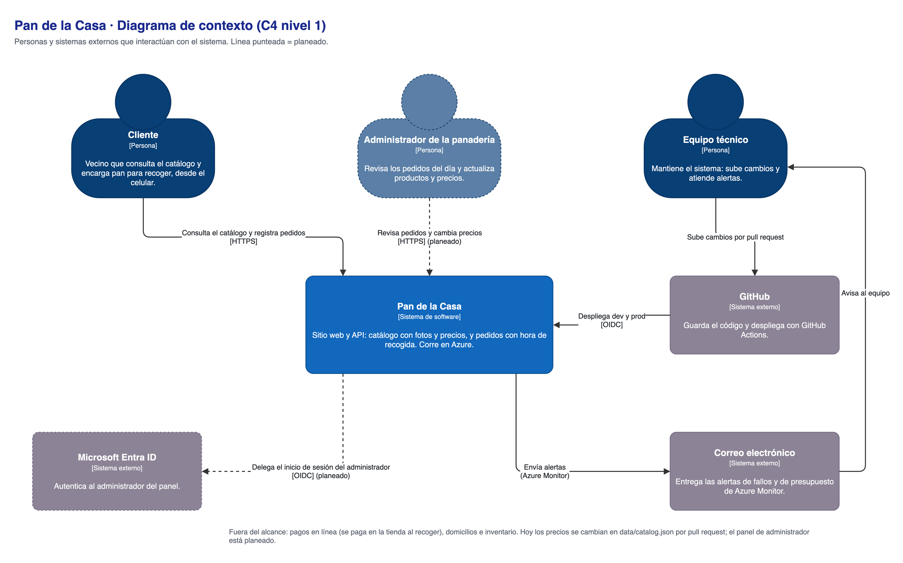
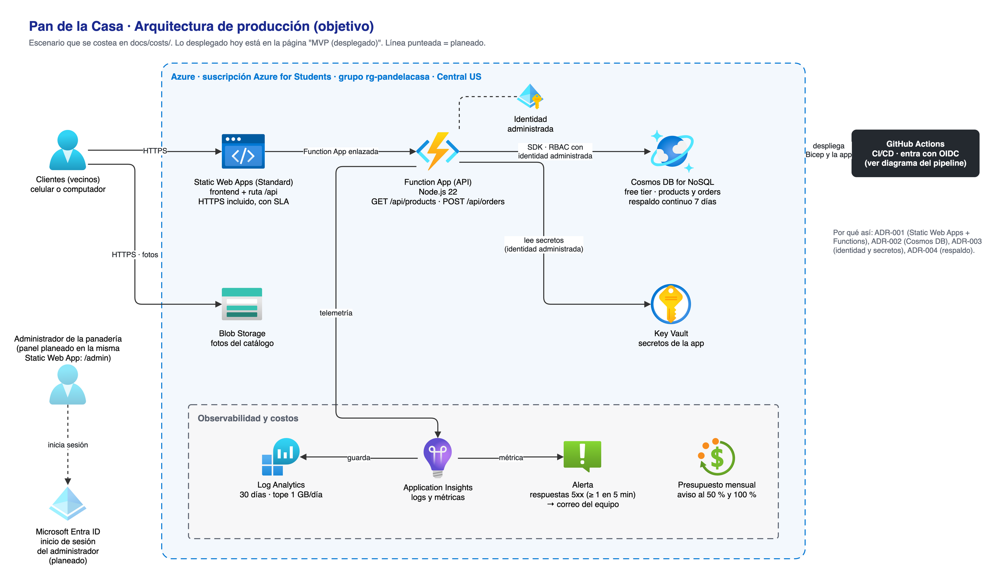
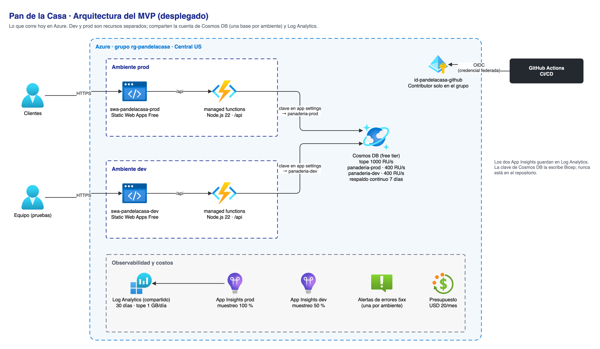
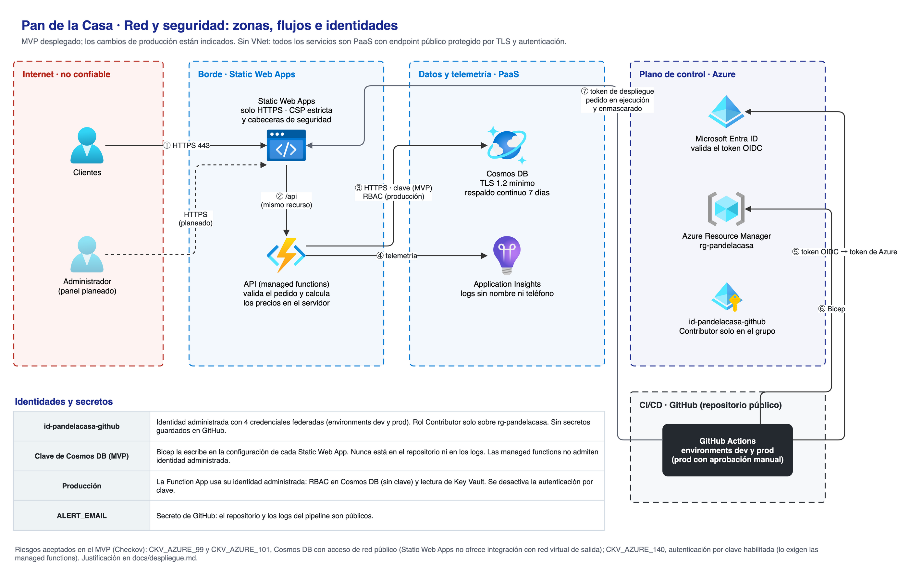

# HLD: Pan de la Casa

Diseño de alto nivel de la plataforma de pedidos web de la panadería "Pan de la Casa".

| | |
|---|---|
| Curso | Paradigmas de Computación en la Nube · Escuela Colombiana de Ingeniería Julio Garavito |
| Equipo | Jean Paul Reales · Juan Diego Valderrama Gaviria |
| Profesor | Luis Carlos Galvis |
| Versión | 1.0 (borrador) · 18 de noviembre de 2026 |
| Repositorio | https://github.com/01REALES01/pan-de-la-casa |
| Sitio en producción | https://gentle-cliff-087349110.6.azurestaticapps.net |

El documento distingue siempre dos escenarios:

- **MVP:** lo que está desplegado hoy en Azure for Students, al costo más bajo posible.
- **Producción:** la arquitectura objetivo que cumple todos los requisitos no funcionales y que se costea en
  `docs/costs/`.

## 1. Contexto del negocio y alcance

**El negocio.** Pan de la Casa es una panadería de barrio con un solo local. Vende amasijos, panes y dulces del día.
Hoy los pedidos llegan por teléfono o en persona. El cliente no sabe si lo que quiere sigue disponible, y en la hora de
más venta hace fila para pagar algo que pudo dejar pedido. Los fines de semana la demanda se triplica (3x).

**Qué resuelve el sistema.** El cliente consulta desde el celular el catálogo con fotos y precios, arma su pedido y
elige a qué hora lo recoge. Recibe un código corto que dice en la tienda. La panadería ve los pedidos del día
organizados por hora de recogida y prepara solo lo pedido.

**Actores.**

| Actor | Qué hace | Estado |
|---|---|---|
| Cliente | Consulta el catálogo y registra pedidos. No crea cuenta. | MVP |
| Administrador de la panadería | Ve los pedidos del día, cambia su estado y edita el catálogo desde un panel. | Planeado |
| Equipo de desarrollo | Cambia el código y el catálogo por pull request; aprueba el paso a producción. | MVP |

**Alcance.**

| | Incluye |
|---|---|
| **MVP (desplegado)** | Catálogo con fotos y precios · carrito · pedido con hora de recogida y código · dos ambientes (dev y prod) · pipeline con pruebas, smoke test y rollback · logs, métricas y alerta |
| **Producción (diseñado)** | Todo lo anterior con SLA · panel del administrador con inicio de sesión · API con identidad administrada · secretos en Key Vault · fotos en Blob Storage |
| **Fuera del alcance** | Pagos en línea (se paga al recoger) · domicilios · inventario y producción · cuentas de cliente · notificaciones por correo o WhatsApp |

## 2. Requisitos funcionales, no funcionales y supuestos

### 2.1 Requisitos funcionales

| ID | Requisito | Estado |
|---|---|---|
| RF-1 | El cliente ve el catálogo agrupado por categoría, con foto, descripción, unidad y precio. | MVP (`GET /api/products`) |
| RF-2 | El cliente arma un pedido, indica nombre, teléfono y hora de recogida, y lo envía. | MVP (`POST /api/orders`) |
| RF-3 | El sistema devuelve un código corto del pedido y el total calculado. | MVP |
| RF-4 | La panadería cambia precios y productos sin tocar código. | MVP: por pull request a `data/catalog.json`. Producción: desde el panel |
| RF-5 | El administrador ve los pedidos del día por hora de recogida y marca cada uno como listo o entregado. | Planeado |
| RF-6 | Solo el administrador entra al panel. | Planeado (Entra ID) |

**Reglas de negocio del pedido** (en `src/api/src/lib/orders.js`, con pruebas unitarias):

- La recogida es entre las 07:00 y las 19:00, hora de Colombia.
- Se pide con al menos 30 minutos de anticipación y como máximo 7 días antes.
- Máximo 20 productos distintos y 50 unidades por producto.
- **Los precios salen del catálogo en el servidor, nunca del navegador:** un cliente no puede cambiar el total.
- Un producto marcado como no disponible no se puede pedir.

### 2.2 Requisitos no funcionales y cómo se cumplen

| Requisito | MVP | Producción | Evidencia |
|---|---|---|---|
| Costo ≤ USD 150/mes en producción | Planes gratuitos y free tier; tope de 1000 RU/s en Cosmos DB; presupuesto de USD 20/mes con avisos | Estimación con la calculadora oficial | `docs/costs/` |
| 99,5 % en horario comercial | Sin SLA (plan Free) | SLA compuesto de 99,89 % (§5.1) | §5.1 |
| HTTPS | Static Web Apps solo sirve HTTPS; Cosmos DB exige TLS 1.2 | Igual | §4.1 |
| Secretos fuera del código | OIDC sin secretos guardados; la clave de Cosmos DB la escribe Bicep en la configuración | Identidad administrada y Key Vault | ADR-003 |
| Mínimo privilegio | Identidad del pipeline con Contributor solo en el grupo de recursos | Además, RBAC de datos para la API | ADR-003, §4.3 |
| RPO 24 h | Respaldo continuo: se pierden como máximo unos 100 segundos | Igual | ADR-004 |
| RTO 4 h | Restauración autoservicio, sin ticket de soporte | Igual | ADR-004, §5.3 |
| Carga 3x | Functions escala sola; caché del catálogo; capacidad medida en §3.3 | Igual | §3.3 |
| Logs, métricas y alerta | Application Insights y Log Analytics; alerta por errores 5xx; presupuesto | Igual | §6 |

### 2.3 Supuestos

Los supuestos de negocio y de tráfico están en `docs/supuestos.md`. Los que ya fija el código o la plataforma son:

| Supuesto | Valor | De dónde sale |
|---|---|---|
| Horario comercial | 07:00–19:00, todos los días (12 h) | Regla de negocio del pedido |
| Productos en el catálogo | 9, en 3 categorías | `data/catalog.json` |
| Tamaño de un pedido | Menos de 1 KB (0,5 KB medido con un pedido de 3 productos) | Medición en dev, 18 nov |
| Costo de guardar un pedido | 12,76 RU | Medición en dev, 18 nov |
| Costo de leer el catálogo | 2,5 RU, una vez cada 30 s por instancia | Medición en dev, 18 nov |
| Administradores del panel | 2 (la dueña y el encargado de turno) | `docs/supuestos.md` |
| Región | Central US | Política de la suscripción (ADR-001) |
| Visitas por día | 150 entre semana · 450 el fin de semana (3x) | `docs/supuestos.md` |
| Pedidos por día | 30 entre semana · 90 el fin de semana (conversión del 20 %) | `docs/supuestos.md` |
| Volumen mensual | 6 900 visitas · 1 380 pedidos · ≈ 8 300 ejecuciones de la API | `docs/supuestos.md` |
| Crecimiento en 12 meses | +50 %: ≈ 10 350 visitas y 2 070 pedidos al mes (base del escenario de producción) | `docs/supuestos.md` |
| Hora pico | Sábado 07:00–09:00: ≈ 30 % de las visitas del día, ≈ 1 visita por minuto | `docs/supuestos.md` |

## 3. Arquitectura propuesta y servicios por capa

### 3.1 Producción (objetivo)

| Capa | Servicio | Configuración | Por qué |
|---|---|---|---|
| Presentación | Azure Static Web Apps **Standard** | HTML, CSS y JS sin build; HTTPS y dominio incluidos; ruta `/api` hacia la API | SLA de 99,95 %; permite enlazar una Function App propia (ADR-001) |
| Aplicación | Azure Functions (Function App propia), Node.js 22 | Plan de consumo (Consumption), enlazada a la Static Web App | Escala sola y no cobra sin tráfico; admite identidad administrada (ADR-001, ADR-003) |
| Datos | Azure Cosmos DB for NoSQL, free tier | Contenedores `products` (`/category`) y `orders` (`/pickupDate`); 1000 RU/s y 25 GB gratis | Documentos JSON sin esquema; respaldo continuo (ADR-002, ADR-004) |
| Archivos | Azure Blob Storage | Fotos del catálogo, servidas por HTTPS | El panel sube fotos sin redesplegar la app |
| Identidad y secretos | Microsoft Entra ID · identidad administrada · Key Vault | Inicio de sesión del administrador; API → Cosmos DB por RBAC; secretos restantes en Key Vault | Sin claves en la configuración (ADR-003) |
| Observabilidad | Application Insights · Log Analytics · Azure Monitor | 30 días de retención, tope de ingesta de 1 GB/día, alerta por errores 5xx, presupuesto | §6 |
| Entrega | GitHub Actions + Bicep | OIDC, dev → smoke test → aprobación → prod; rollback automático | `docs/despliegue.md` |

### 3.2 MVP (desplegado)

El MVP usa la misma forma con planes gratuitos:

- Static Web Apps **Free** con *managed functions*: la API viene incluida en la Static Web App, sin Function App aparte.
- Las fotos se sirven desde la propia Static Web App (`src/web/img/`).
- No hay panel de administrador: el catálogo se cambia por pull request.
- Hay **un recurso de Static Web Apps por ambiente** (`swa-pandelacasa-dev` y `swa-pandelacasa-prod`).
- Dev y prod comparten una cuenta de Cosmos DB, con **una base de datos por ambiente** de 400 RU/s cada una.
- Toda la infraestructura está en `infra/main.bicep` y la crea el pipeline.

**Diferencias entre MVP y producción, y por qué:**

| Aspecto | MVP | Producción | Motivo del cambio |
|---|---|---|---|
| Plan de Static Web Apps | Free | Standard | El Free no tiene SLA |
| API | Managed functions | Function App propia | Identidad administrada y triggers no HTTP |
| API → Cosmos DB | Clave en la configuración | Identidad administrada con RBAC | Quitar la última clave (ADR-003) |
| Fotos | En la Static Web App | Blob Storage | Subirlas desde el panel |
| Panel de administrador | No | Sí, con Entra ID | RF-5 y RF-6 |

### 3.3 Flujo de un pedido y escalado ante el 3x

1. El navegador descarga la página desde Static Web Apps, que la sirve como contenido estático sin consumir cómputo.
2. La página pide `GET /api/products`. La API responde desde una caché de 30 s; si la caché está vencida, lee el
   catálogo en Cosmos DB (2,5 RU).
3. El cliente envía el pedido a `POST /api/orders`. La API valida los datos, recalcula precios y total con el
   catálogo, genera el código y guarda el pedido (12,76 RU) en la partición de su fecha de recogida.
4. La API responde con el código, el total y la hora de recogida.

**Capacidad.** Prod tiene 400 RU/s. Con 12,76 RU por pedido, eso alcanza para unos **31 pedidos por segundo**
sostenidos. Un sábado de producción (+50 %) tiene unos 135 pedidos; aunque llegaran todos en la misma hora serían
135 × 12,76 / 3600 ≈ **0,5 RU/s**, el 0,1 % de la capacidad. Las lecturas del catálogo no crecen con las visitas,
porque cada instancia de la API lo lee como máximo una vez cada 30 s. El 3x de los fines de semana queda muy por
debajo del techo. Si se alcanzara, la API responde 503 con un mensaje para reintentar, la alerta avisa (§6) y prod
puede subir a 600 RU/s sin salir del free tier (ADR-002).

**Escalado del cómputo.** Static Web Apps sirve el contenido estático sin límite de instancias que administrar, y
Functions agrega instancias según las peticiones. No hay que configurar reglas de autoescalado ni encender nada antes
del fin de semana.

## 4. Seguridad e identidad

### 4.1 Transporte y navegador

- Static Web Apps solo sirve **HTTPS**. Cosmos DB exige **TLS 1.2** como mínimo (`minimalTlsVersion`).
- `staticwebapp.config.json` envía cabeceras de seguridad en todas las respuestas:
  - **Content-Security-Policy:** `script-src 'self'`, `connect-src 'self'` y sin estilos ni scripts en línea.
  - **`X-Frame-Options: DENY`**, contra el clickjacking.
  - **`X-Content-Type-Options: nosniff`**.
  - **`Referrer-Policy`**.
- La página no carga nada de terceros: las fuentes y las fotos se sirven desde el propio sitio.

### 4.2 Identidades

| Quién | Cómo se autentica | Qué puede hacer |
|---|---|---|
| Cliente | Anónimo | Leer el catálogo y crear pedidos |
| Administrador (planeado) | Microsoft Entra ID con la autenticación de Static Web Apps; rol `admin` | Rutas `/admin` y `/api/admin/*`, restringidas por rol en `staticwebapp.config.json` |
| Pipeline (GitHub Actions) | OIDC: token de corta duración, aceptado solo desde los environments `dev` y `prod` del repositorio | Contributor **solo** sobre `rg-pandelacasa` |
| API → Cosmos DB, MVP | Clave de la cuenta en la configuración de la Static Web App, escrita por Bicep | Leer y escribir en su base |
| API → Cosmos DB, producción | Identidad administrada de la Function App con un rol de datos de Cosmos DB | Solo los contenedores de su base; la autenticación por clave queda desactivada |

### 4.3 Secretos y mínimo privilegio

- **No hay ningún secreto guardado en GitHub para entrar a Azure** (OIDC, ADR-003).
- El token de despliegue de Static Web Apps y la clave de Cosmos DB se piden en cada ejecución del pipeline y se
  enmascaran en los logs.
- El repositorio y los logs de Actions son públicos. Por eso el correo de alertas va como secreto de GitHub
  (`ALERT_EMAIL`) y ningún archivo contiene IDs de suscripción ni de tenant.
- La rama `main` está protegida: solo entra por pull request con las pruebas y la validación de IaC en verde, y el
  despliegue a prod exige aprobación manual.
- Riesgo aceptado en el MVP: Checkov reporta 3 hallazgos sobre Cosmos DB (acceso público y autenticación por clave).
  Están justificados en `docs/despliegue.md`, con lo que cambia en producción.

### 4.4 Datos personales (Ley 1581 de 2012)

Un pedido guarda el **nombre y el teléfono** del cliente, que son datos personales. Medidas:

- **Datos mínimos:** solo los necesarios para entregar el pedido. No hay cuentas, correos ni direcciones.
- **Fuera de los logs:** la API registra el código, la cantidad de productos y el total, nunca el nombre ni el
  teléfono.
- **Cifrado:** viajan por HTTPS. Cosmos DB los guarda cifrados en reposo de forma predeterminada.
- **Pendiente para producción:**
  - un aviso de privacidad y una casilla de autorización en el formulario, como exige la ley;
  - un tiempo de vida (TTL) en el contenedor `orders`, para que los pedidos se borren solos pasado el plazo que
    defina la panadería.

## 5. Disponibilidad, respaldo y recuperación

### 5.1 Disponibilidad

El requisito es **99,5 % en horario comercial**: 12 h × 30 días = 360 h al mes, con un margen de
**1,8 h (108 minutos) de caída al mes**.

El MVP **no puede prometerlo**, porque el plan Free de Static Web Apps no tiene SLA. Por eso producción usa
Standard. Para atender un pedido intervienen tres servicios en serie. Sus SLA, según el documento oficial de Microsoft
*Service Level Agreements for Online Services* (versión del 17 de noviembre de 2026), son:

| Servicio en la ruta del pedido | SLA |
|---|---|
| Static Web Apps (Standard) | 99,95 % |
| Azure Functions (plan Consumption) | 99,95 % |
| Cosmos DB, una región sin zonas de disponibilidad | 99,99 % |
| **Compuesto** (0,9995 × 0,9995 × 0,9999) | **99,89 %** |

99,89 % sobre un mes completo (730 h) equivale a unos **48 minutos de caída al mes en el peor caso**. Aunque todos
cayeran en horario comercial, quedan por debajo de los 108 minutos permitidos.

Quedan fuera de la cuenta:

- **Key Vault:** la API lee los secretos al arrancar.
- **Blob Storage:** sin fotos, el catálogo y los pedidos siguen funcionando.
- **Application Insights:** no está en la ruta del pedido.

**Una sola región.** Todo corre en Central US, la única región permitida por la suscripción donde existe Static Web
Apps. Una caída regional completa es un riesgo aceptado (§7): una segunda región duplicaría el costo para un negocio
con un solo local.

### 5.2 Respaldo

| Qué | Cómo se recupera |
|---|---|
| Pedidos (`orders`) | Respaldo continuo de Cosmos DB, 7 días, restauración a cualquier segundo (ADR-004) |
| Catálogo (`products`) | Se recarga desde `data/catalog.json` en cada despliegue |
| Infraestructura | `infra/main.bicep`: el pipeline la recrea |
| Código y configuración | Git en GitHub; cada despliegue registra su commit en `version.json` |

### 5.3 RPO y RTO

| | Requisito | Diseño |
|---|---|---|
| **RPO** | 24 h | Cosmos DB copia cada cambio al respaldo en menos de 100 segundos: en el peor caso se pierden unos 2 minutos de pedidos. |
| **RTO** | 4 h | Restauración autoservicio por portal o CLI, sin ticket de soporte. **Medido el 19 nov:** la cuenta restaurada estuvo lista en 10 min 33 s y los pedidos volvieron en unos 12 minutos (`docs/despliegue.md`). |

El procedimiento paso a paso (congelar despliegues, restaurar, copiar los pedidos a la cuenta original y verificar
con el smoke test) está en ADR-004.

| Escenario | Respuesta |
|---|---|
| Un despliegue rompe el sitio | Rollback automático al último commit bueno. Probado el 17 nov: dev volvió sola en menos de 3 minutos y prod no se tocó (`docs/despliegue.md`). |
| Se borran o dañan pedidos | Restaurar a un punto anterior al error y copiar los pedidos con `scripts/restore-orders.js` (ADR-004, paso 3). Probado el 19 nov: un pedido borrado volvió idéntico. |
| Se borra una base o un contenedor | Restauración dentro de la misma cuenta (ADR-004, paso 2). |
| Se borra el grupo de recursos | `scripts/bootstrap.sh` y el pipeline recrean la infraestructura en minutos. Para los pedidos se evalúa restaurar la cuenta borrada desde su respaldo continuo, **antes** de volver a correr el pipeline (si no, el pipeline crea una cuenta vacía con el mismo nombre). No está probado. |

## 6. Observabilidad y operación

### 6.1 Qué se recoge

| Señal | Dónde | Configuración |
|---|---|---|
| Peticiones a la API (ruta, código, duración) | Application Insights → Log Analytics (`AppRequests`) | Un Application Insights por ambiente. En dev se muestrea el 50 % de la telemetría |
| Logs de la API | `AppTraces` | Errores de Cosmos DB y un registro por pedido, sin datos personales |
| Métricas de la plataforma | Application Insights y Cosmos DB | Peticiones, errores, RU consumidas, peticiones con 429 |
| Versión desplegada | `/version.json` | Commit, ambiente y si fue un rollback |

Log Analytics conserva **30 días** con un **tope de ingesta de 1 GB al día**, para que un error que inunde los logs
no dispare el costo. La telemetría llega en los dos ambientes: verificado el 18 de noviembre en `AppRequests`.

### 6.2 Alertas

| Alerta | Condición | A quién avisa |
|---|---|---|
| Errores de servidor | Al menos una respuesta 5xx de la API en 5 minutos. Severidad 1 en prod, 3 en dev | Correo del equipo |
| Presupuesto | Gasto real > 50 % o pronóstico > 100 % de USD 20 al mes | Correo del equipo |

La alerta cuenta las respuestas por **código HTTP**, no la métrica de "peticiones fallidas". Verificamos en
`AppRequests` que Functions marca como exitosa toda respuesta que no lanza una excepción: los 400 del smoke test
llegan con `Success = True`. Con la métrica de fallidas, un 503 por Cosmos DB caído o saturado no habría avisado.

### 6.3 Operación

- **Verificación de cada despliegue:** el smoke test comprueba que se sirve el commit correcto, que `/api/health`
  responde, que el catálogo trae productos y que un pedido inválido se rechaza. Con un pedido inválido no se crean
  pedidos falsos en producción.
- **Consultas útiles en Log Analytics:**
  - errores de la última hora:
    `AppRequests | where TimeGenerated > ago(1h) and toint(ResultCode) >= 500 | summarize count() by Name, ResultCode`;
  - pedidos registrados hoy:
    `AppTraces | where Message startswith "Pedido" | summarize count() by bin(TimeGenerated, 1h)`.
- **Procedimientos:**
  - rollback: `docs/despliegue.md`;
  - restauración de datos: ADR-004;
  - configuración inicial: `scripts/bootstrap.sh`.
- **Responsables:** el equipo recibe las alertas por correo. En horario comercial, una alerta de severidad 1 se
  revisa en menos de 30 minutos.

## 7. Riesgos y mitigaciones

Probabilidad e impacto: A = alto, M = medio, B = bajo.

| # | Riesgo | Prob. | Impacto | Mitigación |
|---|---|---|---|---|
| R1 | El MVP corre en el plan Free, sin SLA. | M | M | Producción usa Standard con SLA (§5.1). El MVP no promete el 99,5 %. |
| R2 | Pedidos falsos en masa: `POST /api/orders` es público y no limita peticiones por cliente. | M | M | Límites por pedido (20 productos, 50 unidades). El tope de 1000 RU/s hace que un abuso termine en errores 503, no en una factura, y la alerta avisa. En producción: límite de peticiones por IP en la API y, si el abuso se repite, Azure Front Door con WAF (costo aparte). |
| R3 | Datos personales sin aviso de privacidad ni autorización (Ley 1581). | A | M | Datos mínimos, fuera de los logs y cifrados (§4.4). Antes de abrir al público: aviso, casilla de autorización y TTL en `orders`. |
| R4 | El panel del administrador no está construido. | A | B | Mientras tanto, el catálogo se cambia por PR y los pedidos se consultan en Cosmos DB. Diseño definido en §4.2. |
| R5 | Clave de Cosmos DB en la configuración de la Static Web App (MVP). | B | A | Nunca está en el repo ni en los logs; la identidad del pipeline solo alcanza el grupo de recursos. En producción, identidad administrada y autenticación por clave desactivada (ADR-003). |
| R6 | Cosmos DB con acceso de red público (MVP). | B | M | TLS 1.2, clave requerida, Checkov documentado. En producción se evalúa un endpoint privado (`docs/despliegue.md`). |
| R7 | Caída de la región Central US. | B | A | Riesgo aceptado: una segunda región duplica el costo. La infraestructura es código y se puede recrear en otra suscripción. |
| R8 | Se superan las 400 RU/s en un pico. | B | M | Caché del catálogo y capacidad medida (§3.3). Prod puede subir a 600 RU/s sin costo (ADR-002). |
| R9 | Un despliegue defectuoso llega a producción. | M | A | Pruebas que bloquean el merge, smoke test en dev, aprobación manual y rollback automático probado. |
| R10 | Pérdida o daño de pedidos por error humano o de código. | B | A | Respaldo continuo de 7 días con restauración autoservicio (ADR-004). |
| R11 | Volver a respaldo periódico con `git revert` bloquea el pipeline. | B | M | El cambio es irreversible en Azure y está advertido en Bicep y en ADR-004. |
| R12 | La suscripción de estudiante agota sus créditos o vence. | B | A | Presupuesto con avisos; el MVP cuesta casi cero. La infraestructura es código y se recrea en otra suscripción con `bootstrap.sh`. |

## 8. Decisiones de arquitectura

Cada decisión está registrada como ADR en `docs/adr/`, con contexto, alternativas evaluadas, decisión y
consecuencias. En la versión PDF se incluyen completas a continuación.

| ADR | Decisión | Alternativas descartadas |
|---|---|---|
| [ADR-001](adr/001-static-web-apps-y-functions.md) | Static Web Apps + Azure Functions; Free en el MVP y Standard con Function App propia en producción | App Service, Container Apps |
| [ADR-002](adr/002-cosmos-db-free-tier.md) | Cosmos DB for NoSQL con free tier y throughput aprovisionado, una base por ambiente | Azure SQL serverless, Table Storage, Cosmos DB serverless |
| [ADR-003](adr/003-identidad-oidc-y-secretos.md) | OIDC con identidad administrada para el pipeline; identidad administrada y Key Vault en producción | Service principal con secreto, token de Static Web Apps guardado |
| [ADR-004](adr/004-respaldo-continuo.md) | Respaldo continuo de 7 días en Cosmos DB | Periódico, continuo de 30 días, exportación propia |
